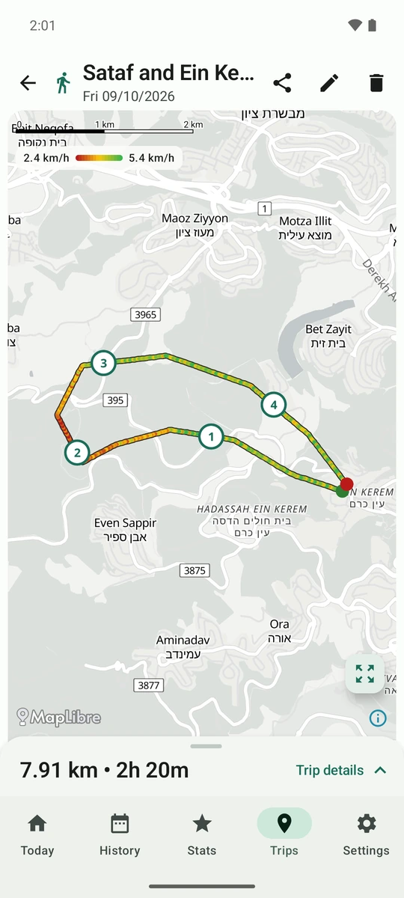
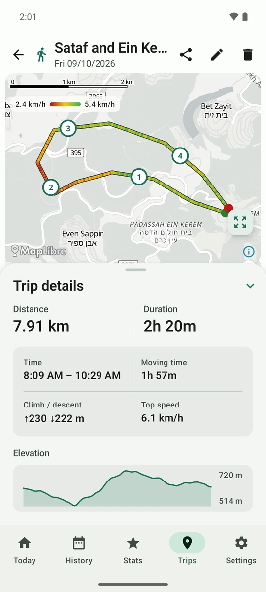

# Steps GPS Route

**An Android app that shows how much you walk each day, and records the GPS route of your hikes,
nature walks and 4x4 drives so you can see them on a map and share them as GPX files.**

<p align="center">
  
  
  
</p>

- **What it does.** It reads your daily steps from Android's Health Connect and shows them against
  a goal. When you start a trip, it records your route until you finish, along with spots you mark
  on the way. Each trip shows on a map colored by speed, with its distance, moving time, top speed
  and heights, and you can share it as a GPX file to open in other map apps.
- **Who it's for.** Anyone who wants a simple daily step count and a plain GPS tracker for
  outings on foot or by car, whose routes they can take to other apps.
- **What it isn't.** It isn't a health, fitness-coaching or medical app. It has no account, no
  cloud, no ads and no analytics: everything stays on the phone.
- **What it needs.** Android 8.0 or newer for trips; Android 14 or newer with Health Connect for
  steps. It's in English on a phone set to English, and in Hebrew (right to left) otherwise.

**Privacy policy:** <https://elibukin.github.io/steps/privacy-policy.html>

## Why this app

I built it for my own use:

- **Daily movement.** I want to see how much I move every day, at a glance.
- **Hikes and nature walks.** I record the route of a hike or a walk in nature with the GPS tracker.
- **4x4 trips.** I also use the GPS tracker on off-road trips with my jeep, so it keeps recording
  at driving speed too.
- **GPX for other apps.** Exporting a trip as GPX is the important part: it lets me open the route
  in other map and navigation apps.

## Not a health app

Steps GPS Route is **not** a health, fitness-coaching or medical app. It gives no health advice, and
nothing in it is meant to diagnose, treat or track any health condition.

It reads your step count from Android's Health Connect only because that's where Android keeps the
phone's step count.

Some stats are there just for fun and are deliberately rough. Don't rely on them:

- calories burned (a flat 0.04 kcal per step);
- burgers burned;
- distance estimated from steps (0.75 m per step);
- progress around the Earth and to the Moon.

The split into *workout* and *incidental* steps is a rule of thumb too.

## Screens

The app has five tabs at the bottom: **Today**, **History**, **Map**, **Trips** and **Stats**.
**Settings** opens from the gear icon at the top of each tab (top right; top left in Hebrew).

The screenshots come from an Android emulator with made-up demo data. They still show the
earlier bottom bar, with Settings as a tab and no Map tab.

<table>
<tr>
<td align="center" valign="top" width="33%"><br><b>Today</b><br>Today's steps against your daily goal, workout and incidental steps, and this week's total.</td>
<td align="center" valign="top" width="33%"><br><b>History</b><br>The last 7 days as bars, with the goal line, then a card for each day.</td>
<td align="center" valign="top" width="33%"><br><b>Stats: Steps</b><br>Lifetime numbers, from total steps to burgers burned.</td>
</tr>
<tr>
<td align="center" valign="top"><br><b>Stats: GPS trips</b><br>Walks and drives counted separately.</td>
<td align="center" valign="top"><br><b>Trips</b><br>Start a trip; earlier trips with a picture of their route.</td>
<td align="center" valign="top"><br><b>Recording</b><br>Clock, distance, GPS signal, <i>Mark spot</i> and <i>Finish trip</i>.</td>
</tr>
<tr>
<td align="center" valign="top"><br><b>Trip</b><br>The route colored by speed, the legend, and numbered spots.</td>
<td align="center" valign="top"><br><b>Trip details</b><br>Distance, duration, moving time, climb, top speed and a height chart.</td>
<td align="center" valign="top"><br><b>A spot</b><br>Its name, time and height, with <i>Rename</i> and <i>Delete</i>.</td>
</tr>
<tr>
<td align="center" valign="top"><br><b>Edit trip</b><br>A name, and Walk or Drive with the app's suggestion marked.</td>
<td align="center" valign="top"><br><b>Share</b><br>Android's share sheet, with the app's own <i>Save file</i> first.</td>
<td align="center" valign="top"><br><b>Settings</b><br>Step goal, workout limits, and <i>Keep deleted trips in Stats</i>.</td>
</tr>
</table>

**In Hebrew and dark mode.** The app follows the phone's dark theme, and in Hebrew the whole
layout runs right to left, including the speed legend and the height chart.

<p align="center">
  
  
  
</p>

## How to use

### First launch: allow Health Connect

1. Open the app. It starts on **Today**.
2. Tap **Grant permission** in the banner at the top. Health Connect opens (the first time, it may
   show an introduction: tap **Get started**).
3. Switch on **Steps** and tap **Allow**. The app asks for nothing else from Health Connect.

<p align="center">
  
  
</p>

On the left, Health Connect's permission screen. On the right, what its *privacy policy* link
opens: how the app uses Health Connect, then the app's full privacy policy (also in **Settings**).

If you tap **Don't allow**, the banner changes to **Open Health Connect**. It opens Health
Connect: go to *App permissions → Steps GPS Route*, switch on **Steps**, and press Back until
you're in the app again; it picks the permission up at once. After two "Don't allow" answers Health
Connect stops asking, so this button is the way back in. **Settings → Permission status** has the
same button.

Your steps appear within a few seconds. The app copies them in whenever you open it, so **open it
at least once every 30 days**: it reaches back only that far.

**If steps stay at 0** (or Today says *Waiting for first step data*), Health Connect has no steps
for the app to read. The app only reads steps; something else has to write them:

- On many Android 14+ phones, Android counts steps into Health Connect by itself.
- Otherwise, an app that counts steps must save them to Health Connect, for example your phone
  maker's health app or your watch's app. Turn on its Health Connect sync, or allow it to write
  **Steps** in Health Connect's settings.
- To check, open Health Connect (search your phone's Settings for "Health Connect") and look under
  its data for Steps.

The daily goal starts at 15,000 steps; change it in **Settings**.

### Today, History and Stats

- **Today** shows today's steps in a ring that fills toward your daily goal, split into
  **workout** steps (brisk walks of 10 minutes or more) and **incidental** steps (everything
  else). Below, this week's total against the weekly goal (daily goal × 7; weeks start on Sunday),
  and when steps were last updated. While Today is open, steps update about once a minute.
- **History** shows the last 7 days as bars split the same way, with the daily goal as a dashed
  line. Below the chart, each day has a card with its total, its share of the goal, its workout
  and incidental steps and the distance estimated from them.
- **Stats** shows lifetime numbers. **Steps**: total steps, estimated distance, workouts and
  workout time, active days, the average per active day, your best day, marathons and the next
  one, and the for-fun ones. **GPS trips**: one card for **Walks** and one for **Drives**, each
  with the number of trips, total time and distance and average speed (walks also show average
  pace). A card with no trips is hidden.

### Recording a trip

1. Go to **Trips** and tap **Start trip**.
2. The app explains why it needs your location; tap **Continue**, then allow **precise** location
   while using the app. On Android 13 and newer it also asks to show notifications: allow it, so
   you get the recording notification with *Mark spot* on the lock screen. If location is off,
   tap **Turn on location**.
3. The green card shows **Recording route**, the elapsed time, the distance and the GPS signal
   (*Searching*, *Weak* or *Good*). Outdoors it usually reaches *Good* within seconds; wait for
   it before you set off.
4. Put the phone away. Recording continues with the screen off or while you use other apps.
5. To stop, tap **Finish trip** and confirm, or tap **Finish** in the notification. The trip
   moves to **Previous trips**.

**If Android stopped the app** during a trip (battery saver, a crash, a force stop), the Trips
screen says **Trip recording was interrupted** the next time you open it. Tap **Resume (with a
gap)** to carry on recording (the time in between shows as a gray dashed line), or **Finish at
last point** to save the trip as it is.

<p align="center">
  
</p>

### Marking spots

While a trip records, **Mark spot** saves where you are, with no questions: a spring, a viewpoint,
a tricky passage, a place to come back to. The app confirms with *Spot 3 marked*, and spots are
numbered per trip.

<p align="center">
  
  
</p>

- **In the app:** the **Mark spot** button on the recording card.
- **From the notification:** pull down the notification shade and tap **Mark spot** under
  *Recording your trip*.
- **From the lock screen:** the same notification shows there; expand it and tap **Mark spot**.
  You don't need to unlock the phone, which helps with a phone in a mount. The notification's
  text says *Spot 3 marked* for a few seconds.

With no GPS fix yet, the app says so and saves nothing. A second tap before you've moved (a double
tap, a bump in the jeep) says the spot *is already marked here*. Names come later: tap the spot on
the trip's map.

### The trip screen

Tap a trip in **Previous trips** to open it.

- **Top bar.** The walk or car icon, the trip's name (or its date, if it has no name), then
  **Share**, **Edit** (pencil) and **Delete** (trash).
- **The map.** An outdoor map (see *Reading the map* below). Drag, pinch to zoom and twist to
  rotate. The button with four arrows shows the whole route again. The green dot is the start and
  the red dot the finish.
- **Colors.** The route is colored by speed, from red (slow) through yellow to green (fast). The
  small legend under the scale bar gives this trip's own km/h at each end, so a walk and a jeep
  drive both use the full range. A gray dashed stretch has no recorded points (the GPS lost its
  fix, or the trip was resumed after an interruption).
- **The panel.** The bar at the bottom shows the distance and duration. Tap it or drag it up for
  **Trip details**: the distance and duration, when the trip started and ended, the **moving
  time** (without stops), **climb / descent**, **top speed**, and an **elevation** chart with the
  highest and lowest point. Tap its top, drag it down or press Back to close it.
- **Spots.** Tap a numbered marker to see the spot's name, when it was marked and its height
  above sea level, with **Rename** and **Delete**.
- **Edit trip.** Give the trip a name (up to 60 characters) and set it to **Walk** or **Drive**.
  The app's own guess, from the trip's speed, is tagged *Suggested*. Stats counts walks and
  drives separately.
- **Delete.** The trash icon deletes the trip, its route and its spots, after you confirm. With
  *Keep deleted trips in Stats* on, its date, time and distance still count in Stats.

Heights above sea level need Android 14 or newer; older phones show the climb, the descent and the
chart's shape only.

### The map

Open the **Map** tab at the bottom. It works whether or not a trip is recording.

- **Where you are.** A blue dot, with a circle for how sure the phone is of it, a soft blue cone
  for the way the phone points (its compass) and, while you move, a small arrow for your
  direction of travel. The map follows you as you go; drag, pinch or rotate it and it stops
  following, and the round **My location** button (crosshairs) follows you again. While the map
  follows you, the screen stays on; it turns off as usual once you move the map away or leave it.
- **Map turns with me.** The compass button, above **My location**, turns the map with the phone,
  so what's in front of you is up. Above 15 km/h (driving, cycling) it turns with your GPS
  direction of travel instead, which a phone in a car holder gets right and its compass often
  doesn't; below 10 km/h it's the compass again. The needle on the button points north; tap it
  to go back to north up. Twisting the map by hand is off meanwhile. On a phone without a
  compass, the map turns only while you move.
- **The trip you're recording,** if one is: its route so far in orange, its start (green) and the
  spots you marked, growing as you go. The button with four arrows shows the whole route and
  where you are.
- **Location permission.** The first time, the map asks for location (approximate is enough here;
  the circle is just bigger). If location is off, it says so, with **Turn on location**. Until the
  first fix comes in, it says *Finding your location...*; an old fix shows as a gray dot.
- **Without internet** the map shows the areas you looked at before, from the map cache, and plain
  ground elsewhere, with your dot, the trip's route and its spots still on it. It fills in by
  itself once you're back online. If the map can't load at all, you get a plain background and
  **Retry map**.
- **Offline map of Israel.** Download it once (**Settings → Offline maps**) and the map works with
  no internet anywhere in Israel, on the Map tab and on a trip's screen. It also shows more than the
  online map: jeep tracks, paths, minor roads (such as Road 171) and wadis from far out, marked
  trails in their trail-mark colors (red, blue, green, black, and the Israel National Trail in
  orange) and contour lines (every 50 m, then every 10 m closer in, with heights). Outside its area
  the app uses the online map as before. With no offline map, a phone in Israel gets a one-time
  offer of it above the map.

The map uses your location only while the Map tab is on screen, with the app in front: switching
to another tab or app stops it at once. Nothing it shows is saved. The trip itself keeps recording
as always, whether the map is open or not. Coming back to the tab, the map is where you left it.
The compass also runs only while the tab is on screen; it needs no permission.

### Reading the map

Both maps use the app's own outdoor map, made for hikes and 4x4 drives in the desert:

- **Unpaved roads and tracks:** brown dashes (solid brown for a paved track). Jeep tracks show
  from about the 1 km scale; below that the map data leaves most of them out.
- **Hiking paths:** red dashes. Footways and sidewalks in towns are paler and thinner.
- **Wadis and seasonal streams:** blue dashes, with their names when zoomed in. A light blue patch
  on a track is a **ford**.
- **Peaks:** a brown triangle with the name and height in meters. Cliffs are a dark line.
- **Ground:** sand and dunes yellow, bare rock gray, woods and fields green. Nature reserves and
  national parks have a green edge, military areas and firing zones a faint red one.
- **Hill shading:** soft shadows show the shape of the land: ridges, valleys and crater walls.
- **Roads** are white with a gray edge, and labels are in the app's language where the map has
  them (Hebrew in Hebrew, English in English), else in the local language.

The map stays light in dark mode: it reads better outdoors, and the route's colors are made for
it. The app's own buttons and panels still follow dark mode.

### Sharing or saving a GPX file

1. On the trip's screen, tap **Share** (the icon at the top).
2. Android's share sheet opens. Its first entry is the app's own **Save file**: pick a folder
   (Downloads, a cloud drive...) and save. Or pick any app that accepts files, such as a messaging
   or email app, or a drive.

The file is called `steps-gps-route-trip-<date>.gpx`. It's a standard GPX 1.1 file: the route as a
track (each point with its time and height), the trip's name, and each spot as a waypoint with its
name, time and height. Open it in any app that imports GPX, such as Organic Maps or OsmAnd, usually
through the app's import option or by opening the file from your Files app.

### Settings

Tap the gear icon at the top of any tab; the back arrow, or Back, returns to that tab.

- **Daily step goal:** type a number and tap **Save**. The weekly goal is 7 times it.
- **Automatic classification thresholds (advanced):** tap **Show** to change the limits that
  decide what counts as a workout; **Reset to defaults** undoes it.
- **Keep deleted trips in Stats:** off by default. When on, a deleted trip's date, time, distance
  and type keep counting in Stats.
- **Offline maps:** **Download** the Israel map (about 151 MB). The download runs in Android's
  download manager, with a notification, and carries on if you leave the app; it shows its progress
  here, with **Cancel**. **Download over Wi-Fi only** is on by default. Once it's on the phone:
  **Delete**, and **Update** when a newer map is out (the app checks only when you open Settings).
- **Permission status** and **Data collection status** tell you whether step reading works.
  Without the permission, **Open Health Connect** opens Health Connect, where you allow **Steps**
  under *App permissions → Steps GPS Route*.
- **Privacy policy:** the app's full privacy policy (in English), the same screen Health Connect's
  privacy-policy link opens. It's built into the app, so it works offline; a link at the top opens
  the latest version online.

### Tips for hikes and 4x4 drives

- **Stop Android from closing the app.** Battery savers can stop a long recording. In Android's
  settings, open *Apps → Steps GPS Route → Battery* and choose **Unrestricted**. On Samsung phones,
  also make sure the app isn't in *Sleeping apps* or *Deep sleeping apps* (*Settings → Battery →
  Background usage limits*). Don't force-stop the app while recording.
- **Keep location on**, and check the card says *GPS: Good* before you start moving. Deep wadis,
  canyons and dense trees weaken the signal.
- **No mobile data needed for recording.** GPS works offline. Only the map itself needs internet:
  offline, the maps show the areas you looked at before (from the map cache) and plain ground
  elsewhere, with your dot and route still on them.
- **Compass.** If the cone points the wrong way, move the phone in a figure 8 a few times to
  calibrate it, away from the car and other metal. A magnet in a phone case or holder throws it
  off.
- **In a vehicle,** put the phone in a mount where it sees the sky (a windshield mount works
  well), keep it charging on long drives, and keep it out of direct sun on the dashboard. Mark
  spots from the lock screen without unlocking.
- **On long hikes,** carry a power bank: recording keeps the GPS on, which uses battery, more so in
  cold weather or with a weak signal.
- **After the trip,** check whether it's a Walk or a Drive and give it a name, so Stats and the
  GPX file make sense later.

### Troubleshooting

| Problem | What to do |
|---|---|
| Steps stay at 0, or *Waiting for first step data* | If the banner asks for permission, allow **Steps** (see *First launch* above). Otherwise Health Connect has no steps: see *If steps stay at 0* above. |
| *Step tracking is not available on this device* | The phone runs Android 13 or older, or has no Health Connect step counting. Trips still work. |
| Health Connect no longer asks for permission | After two "Don't allow" answers it stops asking. Once a request comes back without permission, the banner shows **Open Health Connect** instead (if it still says *Grant permission*, tap that once). Tap it, go to *App permissions → Steps GPS Route*, switch on **Steps**, and press Back. |
| *Open Health Connect* opens the app's Android settings | The phone's Health Connect couldn't be opened directly. Tap *Permissions → Health, fitness and wellness* (the name varies by phone) and switch on **Steps**. |
| *The newest step data is too old* | No new steps came in for 2 days. Check the Health Connect permission and the app that writes your steps. |
| A trip says *interrupted* | Android stopped the app. Resume or finish it, and set the app's battery use to **Unrestricted**. |
| *Precise location required* | You chose approximate location. Tap **Open app settings** and turn on *Use precise location*. |
| No recording notification | Notifications are off for the app. Recording still works; turn them on in the app's settings to get *Mark spot* on the lock screen. |
| The notification isn't on the lock screen | Allow notifications on the lock screen in Android's settings (lock screen or notification settings). |
| *GPS: Searching* while you stand still | Normal: no new points are kept while you don't move. It goes back to *Good* when you walk on. |
| The map is blank or plain | No internet. Areas you looked at before still show; elsewhere the ground is plain, with your dot and route on it. It fills in once you're back online. If it says *Retry map*, tap that. |
| The cone or the turning map points the wrong way | Calibrate the compass: move the phone in a figure 8, away from cars and metal. Above 15 km/h, *map turns with me* uses the GPS direction of travel instead. |
| No blue dot on the map | Tap **Allow** above the map, or **Turn on location**. If it says *Finding your location...*, step outside or wait a little. |
| No heights, climb or chart | The phone didn't report heights for most of the trip. |

## How it works

### Steps

- **Where steps come from.** Android's Health Connect. It holds the step count from the phone's
  built-in step counter, plus steps from any other app or watch you've connected to Health Connect.
  The app reads Health Connect's combined total, minute by minute, and never writes anything back.
- **Requirements.** Android 14 or later, with Health Connect's step counting available. On an older
  or unsupported phone, the app says step tracking isn't available; trips still work.
- **When steps update.** The phone counts steps all the time, whether the app is open or not. The
  app copies the counts in only while it's open: when you open it, about once a minute while
  *Today* is on screen, and right after you grant permission (in the dialog, or in Health
  Connect's own page and back). It never runs in the background.
- **Catching up.** Each update re-reads the last 6 hours, so late or corrected counts are picked
  up. The first update, or one after a long break, reaches back **30 days**. Steps older than that
  are never copied in, so open the app at least once a month.
- **Storage.** The app keeps one record per minute that had steps. An update only adds or corrects
  minutes and never deletes any, so a bad or empty read can't erase your history.
- **Workout vs. incidental.**
  1. Minutes with steps are grouped into walks. A pause of up to 2 minutes stays inside the walk.
  2. A walk is labelled once you've been still for 3 minutes.
  3. It's a **workout** if it lasted at least 10 minutes, had at least 8 minutes with steps and at
     least 600 steps, and averaged at least 60 steps per minute. Otherwise it's **incidental**.

  You can change these limits in Settings. The labels never change the total: every step counts
  as either workout or incidental.

### GPS trips

- **Recording.** You start a trip yourself. While it records, Android shows an ongoing
  notification, and recording continues with the screen off or while you use other apps. You can
  mark spots and finish from the notification or from the app.
- **Interruptions.** If Android stops the app during a trip, the next time you open it the trip is
  marked *interrupted*. You can resume it (the route will have a gap) or finish it at its last
  point.
- **Which GPS points are kept.** The app asks for a location every 10 seconds at high accuracy. It
  skips a point that is less accurate than 30 m, older than 2 minutes, contradicts the speed the
  phone reports, or is just GPS drift while you stand still. Each point is compared with the last
  point the app kept:
  - **Standing still** (the phone reports 0.3 m/s or less for this point and the last kept one), a
    point that is closer to the last kept one than their two accuracies added together is drift,
    and is skipped. The first point after you stop is still kept, so the route reaches where you
    stopped.
  - **On foot** (the phone reports 6 m/s or less, or no speed at all), a point that implies moving
    faster than 6 m/s (about 22 km/h) is skipped.
  - **In a vehicle** (the phone reports more than 6 m/s for this point or the last kept one), the
    limit becomes twice the reported speed plus 3 m/s, and never more than 55 m/s (about
    200 km/h). So a drive records a continuous route, braking included.

  A GPS jump that the phone's own speed can't explain is skipped either way. Phones normally
  measure speed from the satellite signal itself, separately from the position, which is why the
  app trusts it to tell a real drive from a jump.
- **The route you see.** Before the route is drawn, measured or exported, stray points are removed
  and the line is smoothed. The map, the distance and the GPX file all use this same route, so
  they always agree. On foot this includes short GPS excursions: one to three points that jump
  away from your path and back faster than the phone says you were moving (say, about 80 m away
  and back within a minute while the phone reports 5 km/h) are left out, so they add no spur, no
  distance and no false top speed. A real detour or turnaround at your own pace stays, and so does
  everything recorded without the phone's speed or at driving speed. The stored points never
  change; the cleanup runs each time a trip is shown or shared.
- **GPX files.** The file is GPX 1.1, created as "Steps GPS Route". A named trip's name goes into
  the file twice (as the file's and the track's name), since apps differ in which one they show.
  Each marked spot becomes a waypoint (`<wpt>`) with its height, time and name; an unnamed spot is
  called "Spot 3" in the app's language, as the app shows it. Each point's and spot's height
  (`<ele>`) is above sea level on Android 14 and newer; see *Heights above sea level* below.
- **Marked spots.** *Mark spot* saves where you are at once, so it works from a moving jeep. Spots
  are numbered per trip (Spot 1, 2, 3...); a number stays with its spot, so deleting Spot 2
  doesn't turn Spot 3 into Spot 2. Which GPS point a spot uses:
  - Any point the phone delivered from within 30 seconds of the tap (before or after), with an
    accuracy of 50 m or better, counts, including points the route itself skips, such as drift
    while standing still. The spot uses the one closest in time to the tap.
  - The newest point is used at once, unless the phone may have moved more than 40 m since it,
    judged by the speed it reported. On foot any point from the last 30 seconds will do; in a jeep
    at 40 km/h only one from the last 3-4 seconds, since the newest point is often 5-25 seconds
    old there, which would put the spot a few hundred meters back down the track.
  - Otherwise the app asks the GPS for a fresh point and also takes the recording's next one,
    whichever comes first, for up to 10 seconds; with the GPS already on that normally takes a
    second. This is also what makes a spot work while you stand still, when the recording gets no
    new points at all. If nothing closer comes, it uses the best point from those 30 seconds.
  - With no point at all, nothing is saved and the app says there's no GPS fix yet.
  - One point, one spot. The point the last spot used counts as one of those points too, so a
    second tap the phone can't have moved 40 m since lands on that same point: nothing new is
    saved, and the app says "Spot 3 is already marked here". Once you've moved on, a tap is a new
    spot.

  The spot keeps that point's time and height, so they match its place.
- **The recording notification.** It makes no sound and doesn't vibrate, but it isn't a "silent"
  notification in Android's sense (those are hidden on the lock screen by default), so it shows
  there in full, actions included. Its *Mark spot* doesn't ask you to unlock the phone. The answer
  ("Spot 3 marked", or "No GPS fix yet") shows as a short message and, for a few seconds, as the
  notification's text.
- **Walk or drive.** Every finished trip is a *walk* (walks, hikes, jogs) or a *drive*, so Stats can
  keep hikes and jeep drives apart. The app suggests one from the route's speed: each stretch's
  speed, the same one the speed colors use, and the trip is a drive when at least a tenth of its
  stretches are faster than 15 km/h. That is faster than anyone walks or jogs, and slower than a
  jeep on a dirt road. Stops don't count against a drive, since a stop is one long stretch. A trip
  with fewer than 5 stretches is a walk. You can change the type in *Edit trip*; your choice always
  wins, and picking the suggested type again goes back to the suggestion. The suggestion isn't
  stored: it's worked out from the route each time, so an improved rule also applies to old trips.
  It can be wrong: a 4x4 crawl that never goes over 15 km/h is suggested as a walk.
- **Names.** A trip can have a name of up to 60 characters, like "Wadi Qelt hike". Without one,
  the trip is titled by its date.
- **Deleting a trip.** Deleting removes the trip, its route and its marked spots. If *Keep deleted
  trips in Stats* is on (it's off by default), the app first keeps the trip's date, duration,
  distance and type (walk or drive), with no location, no name and no spots, and Stats keeps
  counting it in the right card. Turning the setting off hides those trips from Stats until you
  turn it on again. Trips deleted while it's off are gone from Stats for good.
- **Speed colors.** Each stretch between two points of that same route is colored by its speed:
  distance over time, averaged over about 30 seconds so the color doesn't flicker. Each trip has
  its own scale. Its slowest 5% of stretches are red and its fastest 5% green, so a walk at
  2-6 km/h and a jeep drive at 10-60 km/h both use the full range. The legend shows the trip's
  km/h at the red and green ends, worked out from the same stretches the top speed may come from.
  Slow sits on the left in English and on the right in Hebrew.
  Standing still is just slow, so it's red. A stretch where more than a minute passed *and* you
  moved more than 100 m has no points showing how you got there. That happens when recording was
  interrupted and resumed, or the GPS lost its fix. Such a stretch is drawn gray and dashed, with
  no speed. The GPX file, the trip list's route pictures and the offline outline stay one color.
- **Moving time.** The duration counts everything from start to finish, a 20-minute break
  included. Moving time counts only the stretches whose speed (the same 30-second average the
  colors use) is above 1 km/h on a walk or 3 km/h on a drive. Standing still sends no new points,
  so a stop is one long, nearly motionless stretch, and GPS drift during a break stays well under
  1 km/h, while even a slow scramble is faster. A drive's limit is higher because the stretch
  holding a stop also holds the drive-off up to the next point. Pauses shorter than about half a
  minute blend into the walking around them and count as moving. A gap (gray and dashed on the
  map) counts as moving when its straight line, the least ground you covered, is faster than the
  limit: a short GPS dropout counts, a long interruption spent mostly standing doesn't.
- **Top speed.** The fastest of those 30-second average speeds, never a single GPS reading or the
  phone's own reported speed, so one bad point can't produce a silly number. Gaps have no speed.
  It is never below the speed legend's fast end. A stretch far faster than the phone's own speed
  says (more than twice it plus 1 m/s, such as the GPS position catching up in one jump after
  lagging behind) can't be the top speed, and neither can the stretches whose 30-second average
  takes it in; the route, its colors and its distance stay as they are. The phone measures its
  speed separately from the position, so it doesn't share the lag. At driving speed the phone
  reports a high speed, so a real fast stretch always counts, and so does anything recorded
  without the phone's speed.
- **Heights.** GPS heights scatter 10-20 m up and down, so adding up every rise would turn a flat
  4 km walk into more than a kilometer of climb. The app first smooths the heights along the
  distance (a weighted average in which the heights within about 65 m count most on a walk, and
  more on a drive, whose points are farther apart), then counts climb and descent from valley to
  peak and back, ignoring any rise or fall under 10 m. The highest and lowest point are those of
  the smoothed heights. A trip where fewer than half of the points (or fewer than 10) have a
  height, or whose heights cover less than 100 m of the route, shows no heights at all.
- **Heights above sea level.** The phone reports height above the WGS84 ellipsoid, a mathematical
  shape of the Earth, not above sea level. In Israel that is about 17-20 m higher (Android's own
  model gives about 19-20 m at Jerusalem, 19 m at Tel Aviv and 17 m at Arad and the Dead Sea). The
  app stores what the phone reports and, on Android 14 and newer, converts it to above sea level
  with Android's built-in converter each time a trip is shown or shared, so every trip is
  converted, old ones included. Android 13 and older have no converter: there the trip shows
  climb, descent and the chart's shape, which don't depend on it, but no highest or lowest
  point, and the GPX file gets the heights as stored.
- **Map.** The app's own outdoor style (`app/src/main/assets/map/outdoor-style.json`), drawn by
  MapLibre on [OpenFreeMap](https://openfreemap.org)'s vector tiles (OpenStreetMap data in the
  OpenMapTiles schema, zoom 14 at most), with hill shading from
  [Mapterhorn](https://mapterhorn.com)'s terrain tiles, asked for only up to zoom 12 (squares
  about 8 km across in Israel) and stretched for closer zooms. The style ships inside the app; its
  tiles, fonts and icons are loaded as needed and cached. It's the same light style in dark mode,
  and the route, gaps and dots keep their light-map colors. Labels use the Hebrew or English name
  to match the app's language, else the local name. You can pan, zoom and rotate the map; tilting
  is off. The scale bar is always in meters and kilometers. Without internet the style still
  loads, so the map shows what's cached on its plain land color. Only if the map can't load at
  all does a trip's screen show a plain outline of the route, with a *Retry map* button.
- **Offline maps.** A pack is two [PMTiles](https://docs.protomaps.com/pmtiles/) files: one vector
  file (OpenMapTiles layers z0-14, plus the app's own `outdoor_transportation`,
  `outdoor_waterway`, `trail` and `contour` layers) and one terrain file (Mapterhorn z0-11). They
  live in the app's own folder on the phone's storage (`Android/data/<app>/files/maps`), which
  Android deletes with the app. While the camera's center is inside a pack's area (from zoom 7, or
  at any zoom once the online map failed), the map uses the pack style (`MapPackStyle`): the
  outdoor style pointed at the two files, with fonts and icons from the app's assets and copies of
  its track, path, road and wadi layers reading the outdoor layers at low zoom. Nothing in it goes
  to the network. `scripts/offline-maps/` builds the packs and their list, `maps.json`; the app
  reads that list from the repo's `maps` GitHub release when Settings opens, and downloads with
  Android's download manager (resume, Wi-Fi only, notification, no extra permission), then checks
  each file's size and SHA-256 before using it.
- **The Map tab.** The same outdoor map, with your location from Google Play services'
  location service, asked for every 2 seconds at high accuracy, only while the tab is on screen and
  the app is in the foreground; switching tabs or leaving the app stops it at once. Nothing it gets is
  stored. If the map can't load at all, it switches to a style that is a single background color,
  with no tiles, fonts or icons to download, so your dot and the trip's route still draw on it. While a
  trip records with the map open, Android shares fixes between the two requests, so the recording
  may get a point every 5 seconds instead of every 10; its own rules still decide which it keeps.
- **The compass.** Android's rotation vector sensor (or its magnetometer-only version), read about
  15 times a second only while the Map tab is on screen with the app in front, and only while
  there's a dot or the map turns with it. The heading is where the screen's top edge and the
  phone's back point, so it doesn't jump as the phone tilts from flat to upright, and it follows
  the screen in landscape. It's lightly smoothed, and turned from magnetic to true north with
  Android's model of the Earth's magnetic field at your position (about 5 degrees in Israel).
  *Map turns with me* uses the GPS direction of travel instead from 15 km/h, from a fix under 5
  seconds old, and the compass again below 10 km/h; the gap keeps it from flipping at one speed.

### Steps and trips are separate

Recording a trip doesn't change your step counts, and deleting a trip never removes steps. Trip
code never reads step data, and step code never uses location. The two share only the app's
database file and its screens.

## Permissions

| Permission | Used for | When it's asked |
|---|---|---|
| Health Connect: *Read steps* | Your step counts | When you tap *Grant permission* on *Today*. If you said no, *Open Health Connect* opens Health Connect, where you can allow it under *App permissions*. |
| Precise location | Recording a trip's route | When you tap *Start trip* or *Resume*, after the app's own explanation |
| Notifications | The notification shown while a trip records | Together with location, on Android 13 and later. Recording still works if you say no. |
| Foreground service (location) | Recording with the screen off | Granted automatically |
| Location (approximate is enough) | Your blue dot on the **Map** tab | When you tap *Allow* above the map. Already granted if you've recorded a trip. |
| Internet | Loading the map (OpenFreeMap) and its hill shading (Mapterhorn) on a trip's screen and the **Map** tab; downloading an offline map you ask for (GitHub) | Granted automatically |

The app never asks for background location. It uses location only while a trip is recording or
the **Map** tab is open. The compass needs no permission.

## Privacy and data

The full privacy policy is at <https://elibukin.github.io/steps/privacy-policy.html>, and in the
app under **Settings → Privacy policy**. In short:

- Steps, trips and settings are stored only on the phone. Android's cloud backup is turned off for
  this app.
- The app sends nothing to the developer or anyone else. Its only internet traffic is loading the
  map from OpenFreeMap, and its hill shading from Mapterhorn, while a trip's screen or the **Map**
  tab is open. Those requests don't include your GPS points, but like any map they show
  OpenFreeMap and Mapterhorn which area you're looking at (on the Map tab, usually the area around
  you), and your IP address. Mapterhorn keeps request logs, with IP addresses, for up to 30 days.
- An offline map downloads only when you tap **Download** or **Update**, from GitHub, which sees
  your IP address like any download; the app checks GitHub for a newer map only when you open
  Settings. Inside a downloaded map's area, the map makes no internet requests at all.
- The compass reads the phone's sensors only while the Map tab is open, and nothing it reads is
  stored or sent.
- Locations come from Google Play services' location service on the phone, which may also use
  Wi-Fi and mobile networks, depending on the phone's location settings.
- A GPX file leaves the app only when you save or share it yourself.
- Step data is never written back to Health Connect.

## Map data and licenses

The map's (i) button lists these credits too.

- **Map data** © [OpenStreetMap](https://www.openstreetmap.org/copyright) contributors, under the
  Open Database License.
- **Vector tiles** in the [OpenMapTiles](https://openmaptiles.org) schema (© OpenMapTiles), served
  free by [OpenFreeMap](https://openfreemap.org), which also serves the map's fonts and icons.
- **Hill shading** © [Mapterhorn](https://mapterhorn.com/attribution), built from open elevation
  data; that page lists each source, such as Copernicus GLO-30 worldwide and a 10 m model of Israel.
- **The outdoor style** is the app's own, written for it. A few of its rules, such as the road
  number signs, follow OpenMapTiles' [OSM Bright](https://github.com/openmaptiles/osm-bright-gl-style)
  style (© MapTiler.com & OpenMapTiles contributors, © Mapbox; code BSD 3-Clause, design CC BY 4.0).
- **MapLibre Native** and **maplibre-compose** draw the map (BSD 2-Clause and BSD 3-Clause).
- **Offline maps** are built from the same sources: OpenStreetMap data (© OpenStreetMap
  contributors; the packs are published under the Open Database License, and
  `scripts/offline-maps/` is how they're made), OpenMapTiles' schema (© OpenMapTiles, CC BY 4.0),
  Natural Earth (public domain) at low zoom, and Mapterhorn's terrain (© Mapterhorn; in Israel
  from Copernicus GLO-30, © DLR e.V. 2010-2014 and © Airbus Defence and Space GmbH 2014-2018
  provided under COPERNICUS by the European Union and ESA, and ASTER GDEM, courtesy of METI and
  NASA). Planetiler, GDAL and tippecanoe build them; none of them ships in the app.
- **Fonts and icons for offline maps** ship in the app: Noto Sans (© The Noto Project Authors,
  SIL Open Font License 1.1, text in `app/src/main/assets/map/glyphs/OFL.txt`) and OpenFreeMap's
  map icons (MIT; the POI icons are Maki, CC0).

## Known limitations

- **Driving needs the phone's speed.** Above about 22 km/h, points are kept only while the phone
  reports its speed. GPS points normally include it; if the phone stops reporting it, points are
  skipped until you slow down, and the route shows a straight jump.
- **GPS jumps are harder to catch while driving.** The faster the phone says you're going, the
  bigger the gap between two points the app allows, and the out-and-back cleanup above is for
  walking only (at driving speed a hairpin bend has the same shape). While driving, a stray point
  a few hundred meters to the side of the road can stay in the route.
- **"Searching" while standing still.** The GPS status can show *Searching* after 30 seconds
  without moving, because no new points are kept then.
- **Heights are only as good as GPS.** Even after smoothing, the climb and descent are estimates,
  good to about 10-20%, and the highest and lowest point are often 5-10 m off. A slow drift of the
  GPS height over minutes looks just like a gentle hill, so a flat walk can still show some climb,
  and hills smaller than about 10-15 m are missed. Telling the two apart would need a barometer,
  which the app doesn't use.
- **Steps update only while the app is open.** The phone keeps counting, but if you don't open
  the app for more than 30 days, the steps from before that are never copied in.
- **Android 14+ only for steps.** Older phones get no step counting.
- **Workout vs. incidental is a guess.** A long, brisk walk to the shop counts as a workout.
- **A trip stops if Android closes the app.** It stays *interrupted* until you resume it.
- **Spots on the map only.** Spots show on the online map, not on the offline outline, and
  TalkBack can't reach a single spot on the map: the map's description only says how many there
  are. Their heights show only on Android 14 and newer.
- **A permission answer can be lost.** If the screen rotates while a permission dialog is open,
  tap *Start trip* again.
- **The map's detail.** Online, zoomed out past about the 1 km scale, the map data leaves out most
  tracks and paths, and there are no contour lines or marked-trail colors; the offline map of
  Israel has them. There are no 4x4 grades either way.
- **Offline maps: Israel only, for now.** Where two marked trails share a path, only one color
  shows. Crossing the edge of the offline map's area (or zooming out past about zoom 7) switches
  between it and the online map, which redraws the map once. An update downloads the whole map
  again.
- **The compass is only as good as the phone's.** Near a car, metal or a magnet it can be off by
  tens of degrees until it's calibrated.

## For developers

> The project and its Kotlin package are still called **StepSplit** (`com.example.stepsplit`).
> The app's ID on phones and Google Play is `bukin.stepsgpsroute` (`bukin.stepsgpsroute.debug` for
> debug builds).

### Project structure

A single `app` module in Kotlin and Jetpack Compose. Dependencies are wired by hand in
`di/AppContainer.kt` (no DI framework). Data flows from Room and DataStore through repositories into
ViewModels (`StateFlow`), and from there to the Compose screens.

```
app/src/main/java/com/example/stepsplit/
  ui/               Compose screens (today, history, stats, trips, map, settings), navigation, theme
  di/               AppContainer and ViewModelFactory
  domain/           Pure Kotlin, no Android: walk classification, aggregation, time,
                    lifetime stats, and the trip route logic (point acceptance, cleanup, smoothing,
                    speed colors, walk/drive, moving time and top speed, elevation, which GPS
                    point a marked spot uses)
  data/
    stepsource/     Health Connect step source (+ a fake for tests and debug data)
    repository/     StepRepository: imports, stores and classifies steps
    trip/           TripRepository, GPS location client, recording coordinator, spot marker,
                    sea-level heights
    local/          Room database, entities and DAOs
    settings/       DataStore settings (goal, thresholds, last sync, keep deleted trips)
    mappack/        Offline map packs: the server's list (maps.json), the files on the phone,
                    downloads through Android's download manager
  trip/service/     The trip recording foreground service and its command handling
  sync/             Cancels a background job left by older app versions (nothing is scheduled)
  debug/            Debug-only sample data and device diagnostics
scripts/offline-maps/  Builds the offline map packs and maps.json (see its README)
```

The privacy policy's source is `docs/privacy-policy.html`. It's published on GitHub Pages from the
`gh-pages` branch, as `index.html` and `privacy-policy.html`. Each build also copies it into the
app's assets (`CopyPrivacyPolicyTask` in `app/build.gradle.kts`), where the Health Connect
rationale screen, `ui/PermissionsRationaleActivity.kt`, shows it in a WebView with network loads
blocked. Health Connect requires that screen to show the same policy as the Play listing, so
publish the policy whenever a release ships a changed copy. The page must stay self-contained (no
scripts, images, stylesheets or fonts from elsewhere); a unit test checks this. A draft of the
Google Play store listing is in `docs/store-listing.md`, and the README's screenshots are in
`docs/screenshots/`.

### Build, install, test

You need **JDK 21** (the unit tests need it; building alone works with JDK 17) and the Android SDK
with platform 36.

```bash
./gradlew assembleDebug        # APK: app/build/outputs/apk/debug/app-debug.apk
./gradlew installDebug         # installs on every connected device and emulator
./gradlew testDebugUnitTest    # unit tests (JVM + Robolectric)
./gradlew lintDebug
```

- **Tests.** About 720 unit tests. Business logic is pure Kotlin; Room and the screens' ViewModels
  run under Robolectric. There are no instrumented (on-device) tests.
- **Step separation.** `ArchitectureInvariantsTest` scans the code to make sure step and trip code
  don't import each other, and `StepGpsSeparationTest` runs both features together.
- **Real phone.** Step counting needs a real phone with Health Connect step counting. Most
  emulator images report step tracking as unavailable, because their SDK extension level is
  below 20.
- **Emulator.** Trips can be tested on an emulator by feeding it positions with
  `adb emu geo fix <longitude> <latitude>`, about one per second.
- **Map renderer.** The trip map uses MapLibre's OpenGL ES build (`android-sdk-opengl`) instead of
  the Vulkan one maplibre-compose brings, so Google Play doesn't hide the app from phones without
  Vulkan. Keep `maplibreAndroid` in `gradle/libs.versions.toml` at the version maplibre-compose
  asks for. On an emulator started with `-gpu swiftshader_indirect`, the map then misses its
  labels, spot numbers and gap lines, a known emulator bug
  ([maplibre-native#3648](https://github.com/maplibre/maplibre-native/issues/3648)); start it with
  `-gpu swangle` instead.
- **Debug tools.** Debug builds (`bukin.stepsgpsroute.debug`) add a *Debug tools* section in
  Settings:
  - *Generate sample data*: a week of fake steps, stored under a separate source so they never
    count toward lifetime stats;
  - a step source check;
  - device diagnostics.

  None of this exists in release builds.

### Releasing

Google Play releases are built, checked and signed with `scripts/release.sh`, from one commit in
an isolated checkout, into a read-only, git-ignored `dist/` folder. The upload key stays outside
the repository, and `jarsigner` asks for its password. See [docs/RELEASING.md](docs/RELEASING.md)
for the upload key, version codes and the release steps:

```bash
scripts/release.sh build main                      # gates + checks -> dist/<release>/
scripts/release.sh sign dist/<release> <keystore> upload
scripts/release.sh test-apk dist/<release>         # debug-key copy of the release APK for testing
```

Debug builds installed before the ID change (`com.example.stepsplit.debug`) are a separate app;
docs/RELEASING.md also explains how to move their data.

### Database

- **Version.** Room schema version **10**. The 9→10 migration added the empty `trip_spots` table
  for marked spots, which are deleted with their trip. The 8→9 migration added trip names and
  types: existing trips get no name and keep the suggested type, and deleted trips kept in Stats
  from before then get their type from their average speed (10 km/h or more is a drive; their
  route is gone). Each version's schema is exported to `app/schemas/` and
  committed. Migrations never delete steps or change step counts; the 5→6 migration did drop the
  old manual-relabelling table (`session_overrides`).
- **Migration tests.** Each step from 1→10 has a test in `StepSplitDatabaseMigrationTest`. It
  builds the old schema from its exported JSON, migrates, and lets Room validate the result.
- **Unused leftovers.** Some tables and columns from removed features are kept but unused:
  `manual_walks`, `activity_intervals`, `motion_evidence`, `temporal_continuity_state`,
  `step_counter_samples`, and the validation columns in `step_buckets`. Dropping them would need
  its own migration.
- **Step source id.** Steps from Health Connect are stored under the source id
  `local_recording_api`, the old source's id, so earlier history stayed in place without a
  migration.
