# Steps GPS Route

**A free, simple Android tool: your everyday steps, and GPS recording and a map to find your way
on hikes and off-road 4x4 drives.**

<p align="center">
  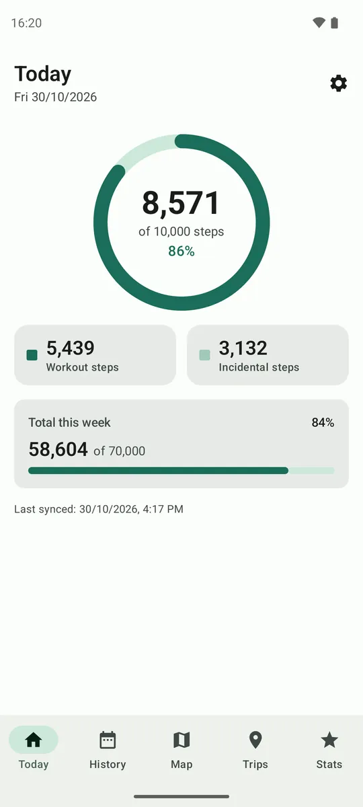
  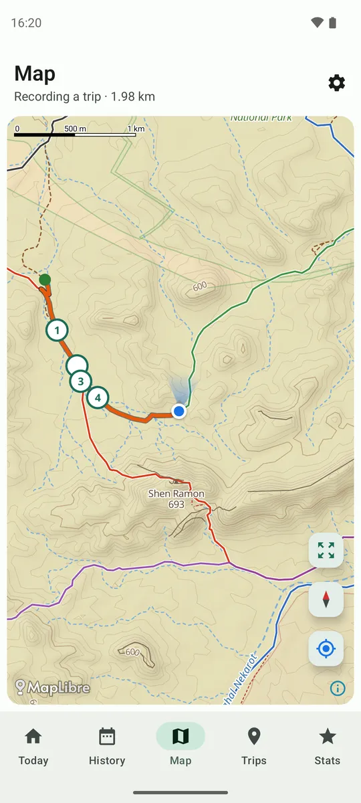
  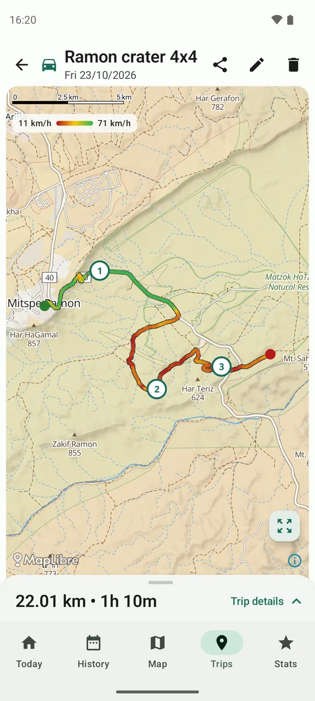
  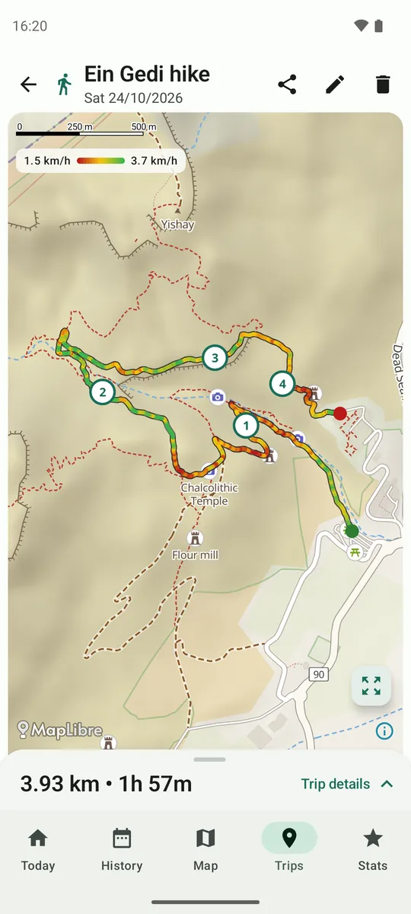
</p>

> I built this app because I needed a robust, simple and free tool: one that keeps track of my
> everyday movement by counting steps, and that records my route and helps me stay oriented and
> find my way when I'm hiking or driving off-road in a 4x4. It's not a sport app, just a useful
> tool.

## What it does

- **Daily steps.** Today's steps in a ring against your goal, the last 7 days, and lifetime
  numbers. The steps come from Android's Health Connect; the app only reads them.
- **GPS trips.** Tap *Start trip* before a hike or a drive. The app records your route, on foot or
  at driving speed, with the screen off, until you tap *Finish*.
- **Spots.** Mark a spring, a junction or a viewpoint as you go: from the app, from the
  notification, or from the lock screen without unlocking.
- **An outdoor map.** Trails, wadis and jeep tracks, peaks and hill shading. Your position with a
  compass cone, and a map that can turn with you. The trip you're recording draws on it as you go.
- **An offline map of Israel.** Download it once (150 MB) and the map works with no signal, with
  marked trails in their colors, jeep tracks, wadis and contour lines.
- **Every trip on a map.** Colored by speed, with your spots, its distance, moving time, climb,
  top speed and a height chart. Walks and drives are counted separately.
- **GPX.** Share or save any trip as a GPX file, to open it in other map and navigation apps.
- **Routes from GPX files.** Someone sends you a planned hike or 4x4 route? Open it with the app
  and follow it on the map, online or offline, with how far you've come and how far is left.

## Just a tool

- **Not a sport or fitness app.** No training plans, badges, streaks, leaderboards or feed. There's
  one daily step goal, which you set yourself.
- **Not a health app either.** It gives no health advice. Calories, "burgers burned" and the other
  fun numbers are rough estimates.
- **Your data stays on your phone.** No account, no ads, no analytics, no tracking. Nothing is sent
  to me or to anyone else. Location is used only while a trip records or the map is open.
- **Free.** No price, no in-app purchases.

The only internet use is loading the map (from OpenFreeMap, with hill shading from Mapterhorn) and
downloading the offline map when you ask for it (from GitHub). Inside the offline map's area, the
map needs no internet at all.

**Privacy policy:** <https://elibukin.github.io/steps/privacy-policy.html> ·
**Web page:** <https://elibukin.github.io/steps/>

## Requirements

- **Android:** 8.0 or newer for trips and the map; 14 or newer, with Health Connect, for steps.
- **Languages:** English on a phone set to English, and Hebrew (right to left) otherwise.

## Screens

Five tabs at the bottom: **Today**, **History**, **Map**, **Trips** and **Stats**. **Settings**
opens from the gear icon at the top of each tab (top right; top left in Hebrew).

The screenshots come from an Android emulator with made-up data: invented trips along real trails
and tracks (Makhtesh Ramon, Ein Gedi, Nahal Prat, Arad to the Dead Sea) and invented steps. The
maps show OpenStreetMap data.

<table>
<tr>
<td align="center" valign="top" width="33%"><br><b>Today</b><br>Today's steps against your daily goal, workout and incidental steps, and this week's total.</td>
<td align="center" valign="top" width="33%">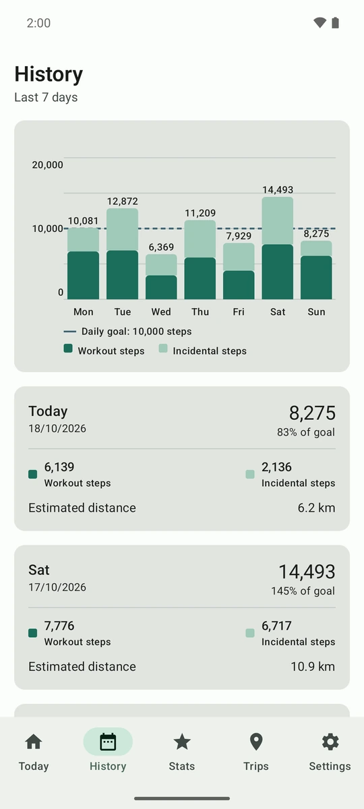<br><b>History</b><br>The last 7 days as bars, with the goal line, then a card for each day.</td>
<td align="center" valign="top" width="33%">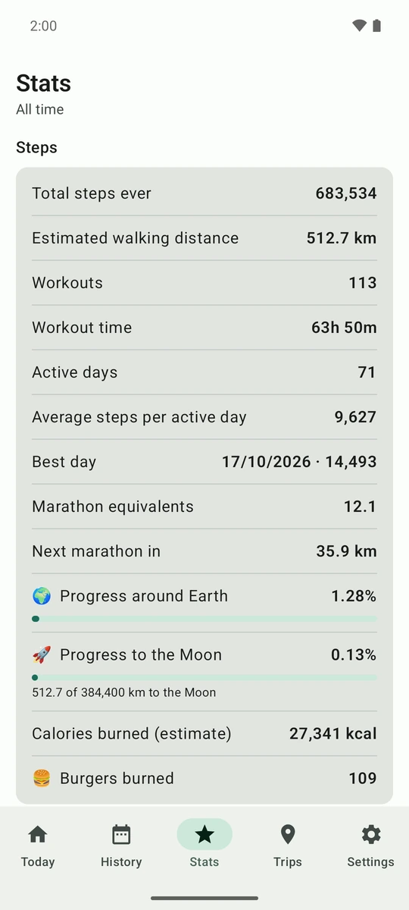<br><b>Stats: Steps</b><br>Lifetime numbers, from total steps to burgers burned.</td>
</tr>
<tr>
<td align="center" valign="top">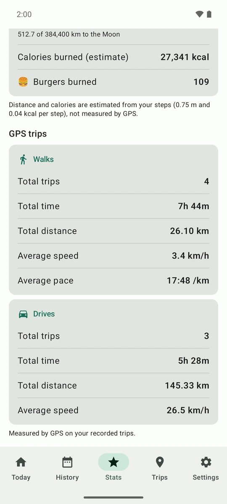<br><b>Stats: GPS trips</b><br>Walks and drives counted separately.</td>
<td align="center" valign="top">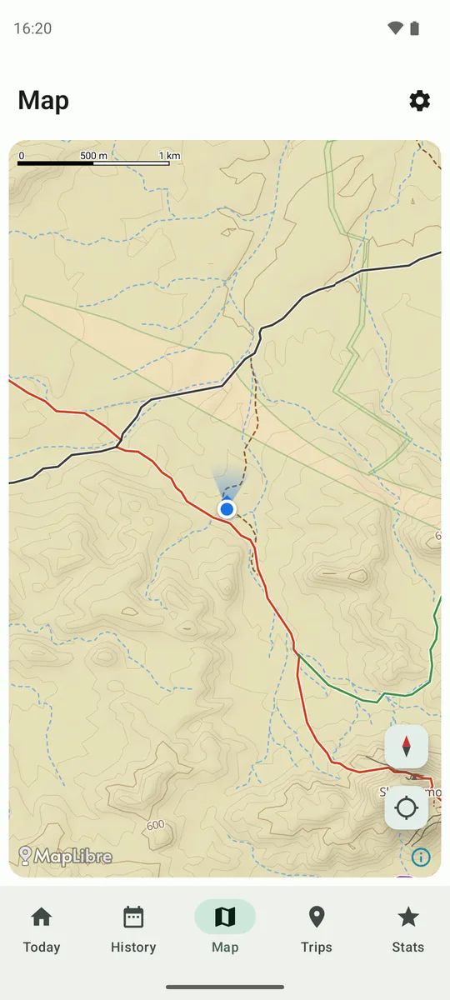<br><b>Map</b><br>Where you are, with a compass cone, on the offline map: marked trails, wadis, contour lines.</td>
<td align="center" valign="top"><br><b>Map while recording</b><br>The trip so far in orange, with the spots you marked.</td>
</tr>
<tr>
<td align="center" valign="top">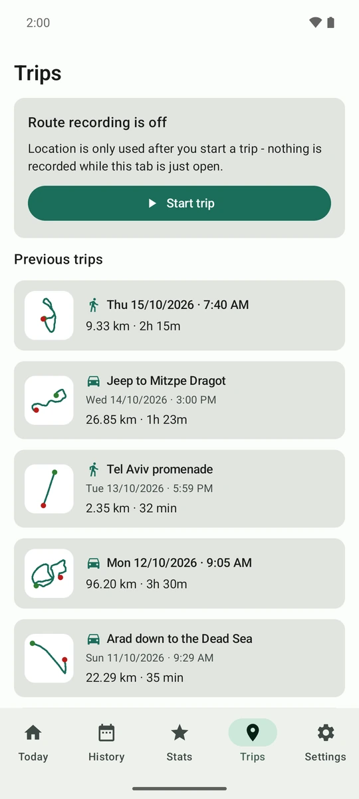<br><b>Trips</b><br>Start a trip; earlier trips with a picture of their route.</td>
<td align="center" valign="top">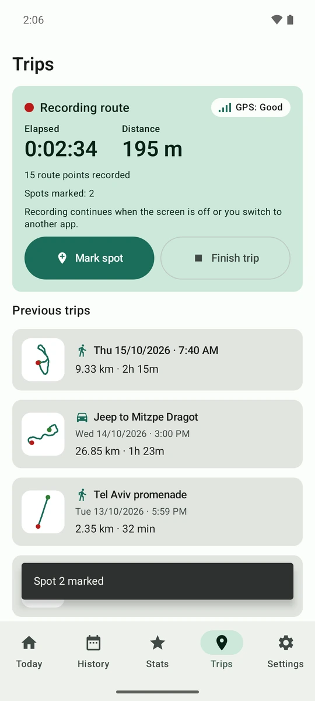<br><b>Recording</b><br>Clock, distance, GPS signal, <i>Mark spot</i> and <i>Finish trip</i>.</td>
<td align="center" valign="top"><br><b>A 4x4 drive</b><br>The route colored by speed (here 11 to 71 km/h), with numbered spots.</td>
</tr>
<tr>
<td align="center" valign="top"><br><b>A hike</b><br>The same for a walk: its own speed scale, marked paths, spots.</td>
<td align="center" valign="top">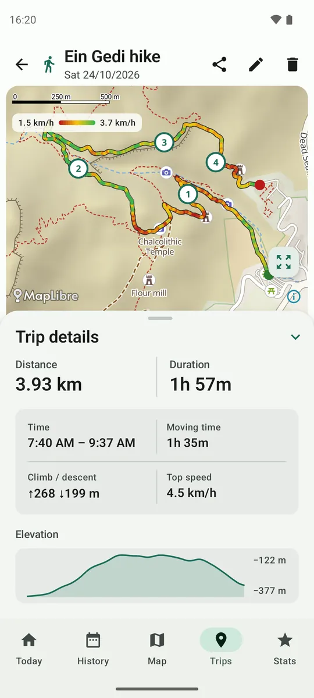<br><b>Trip details</b><br>Distance, duration, moving time, climb, top speed and a height chart.</td>
<td align="center" valign="top">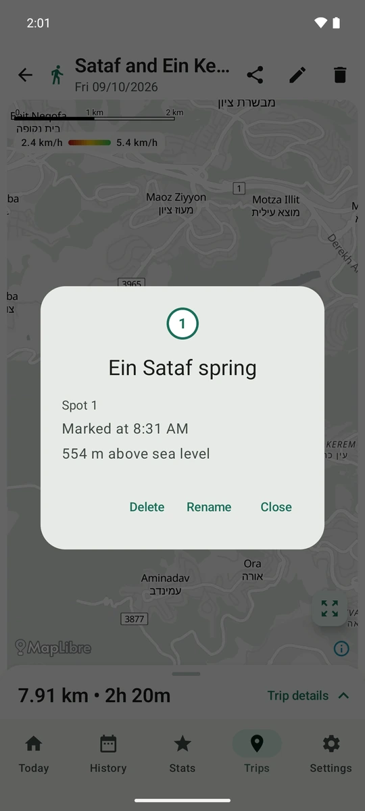<br><b>A spot</b><br>Its name, time and height, with <i>Rename</i> and <i>Delete</i>.</td>
</tr>
<tr>
<td align="center" valign="top">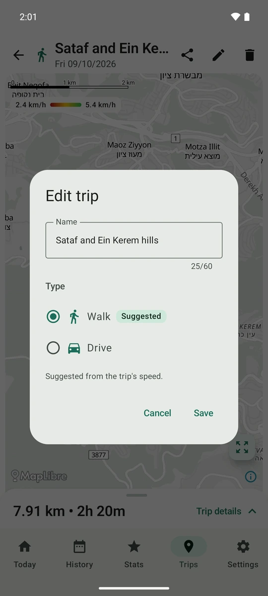<br><b>Edit trip</b><br>A name, and Walk or Drive with the app's suggestion marked.</td>
<td align="center" valign="top">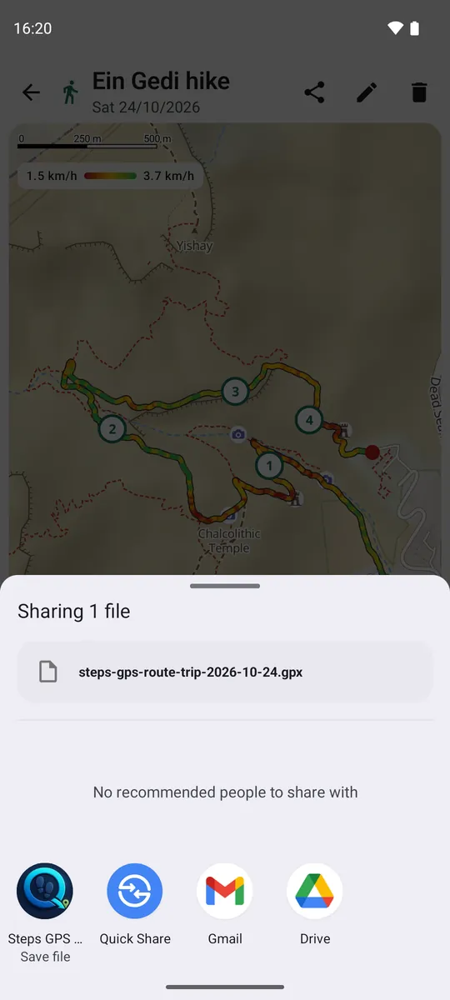<br><b>Share GPX</b><br>Android's share sheet, with the app's own <i>Save file</i> first.</td>
<td align="center" valign="top">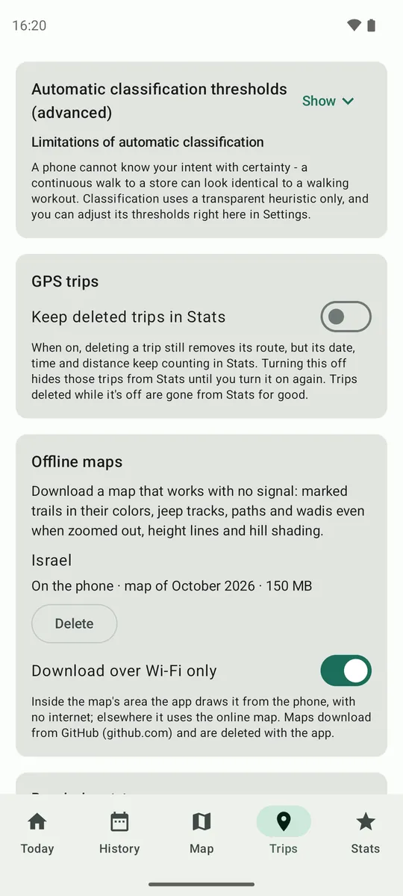<br><b>Settings: Offline maps</b><br>The Israel map, downloaded once and used with no signal.</td>
</tr>
</table>

**In Hebrew and dark mode.** The app follows the phone's dark theme (the map stays light, which
reads better outdoors), and in Hebrew the whole layout runs right to left, including the speed
legend and the height chart.

<p align="center">
  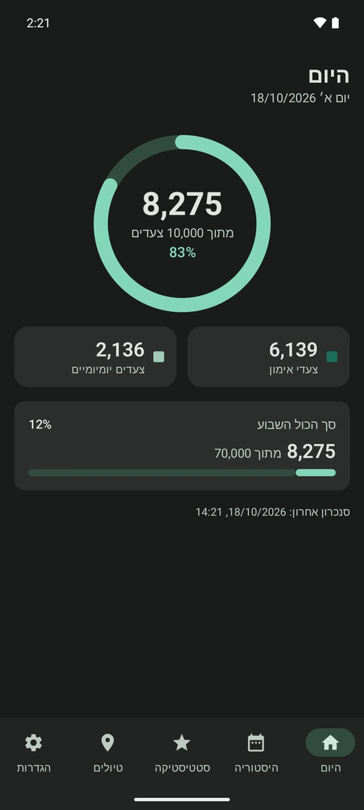
  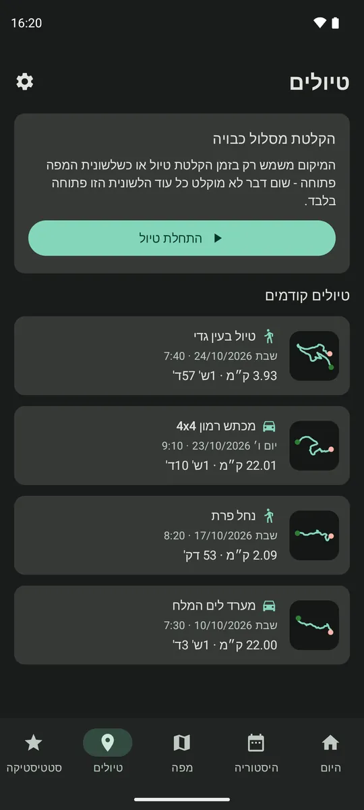
  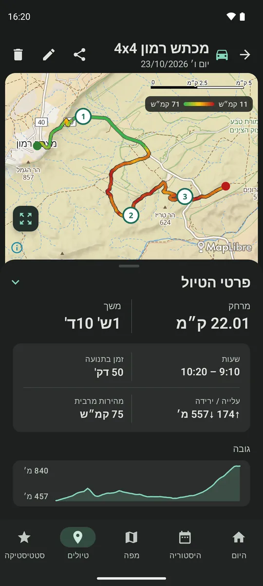
  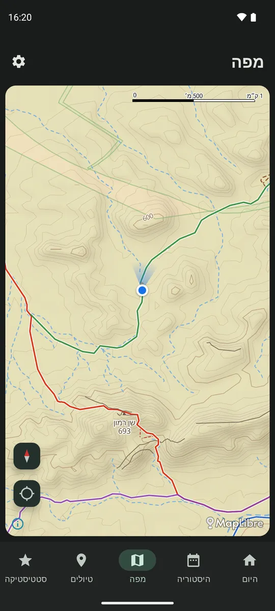
</p>

## How to use

### First launch: allow Health Connect

1. Open the app. It starts on **Today**.
2. Tap **Grant permission** in the banner at the top. Health Connect opens (the first time, it may
   show an introduction: tap **Get started**).
3. Switch on **Steps** and tap **Allow**. The app asks for nothing else from Health Connect.

<p align="center">
  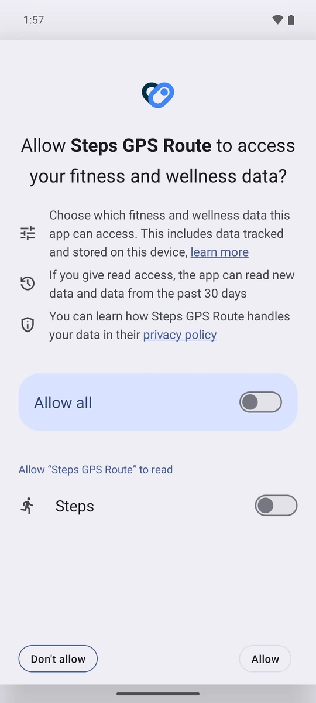
  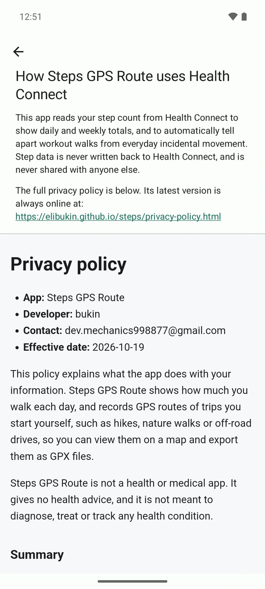
</p>

On the left, Health Connect's permission screen. On the right, what its *privacy policy* link
opens: how the app uses Health Connect, then the app's full privacy policy (also in **Settings**).

If you tap **Don't allow**, the banner changes to **Open Health Connect**. It opens Health
Connect: go to *App permissions → Steps GPS Route*, switch on **Steps**, and press Back until
you're in the app again; it picks the permission up at once. After two "Don't allow" answers Health
Connect stops asking, so this button is the way back in. **Settings → Permission status** has the
same button.

Your steps appear within a few seconds. The app copies them in whenever you open it, so **open it
at least once every 30 days**: it reaches back only that far.

**If steps stay at 0** (or Today says *Waiting for first step data*), Health Connect has no steps
for the app to read. The app only reads steps; something else has to write them:

- On many Android 14+ phones, Android counts steps into Health Connect by itself.
- Otherwise, an app that counts steps must save them to Health Connect, for example your phone
  maker's health app or your watch's app. Turn on its Health Connect sync, or allow it to write
  **Steps** in Health Connect's settings.
- To check, open Health Connect (search your phone's Settings for "Health Connect") and look under
  its data for Steps.

The daily goal starts at 15,000 steps; change it in **Settings**.

### Today, History and Stats

- **Today** shows today's steps in a ring that fills toward your daily goal, split into
  **workout** steps (brisk walks of 10 minutes or more) and **incidental** steps (everything
  else). Below, this week's total against the weekly goal (daily goal × 7; weeks start on Sunday),
  and when steps were last updated. While Today is open, steps update about once a minute.
- **History** shows the last 7 days as bars split the same way, with the daily goal as a dashed
  line. Below the chart, each day has a card with its total, its share of the goal, its workout
  and incidental steps and the distance estimated from them.
- **Stats** shows lifetime numbers. **Steps**: total steps, estimated distance, workouts and
  workout time, active days, the average per active day, your best day, marathons and the next
  one, and the for-fun ones. **GPS trips**: one card for **Walks** and one for **Drives**, each
  with the number of trips, total time and distance and average speed (walks also show average
  pace). A card with no trips is hidden.

### Recording a trip

1. Go to **Trips** and tap **Start trip**.
2. The app explains why it needs your location; tap **Continue**, then allow **precise** location
   while using the app. On Android 13 and newer it also asks to show notifications: allow it, so
   you get the recording notification with *Mark spot* on the lock screen. If location is off,
   tap **Turn on location**.
3. The green card shows **Recording route**, the elapsed time, the distance and the GPS signal
   (*Searching*, *Weak* or *Good*). Outdoors it usually reaches *Good* within seconds; wait for
   it before you set off.
4. Put the phone away. Recording continues with the screen off or while you use other apps.
5. To stop, tap **Finish trip** and confirm, or tap **Finish** in the notification. The trip
   moves to **Previous trips**.

**If Android stopped the app** during a trip (battery saver, a crash, a force stop), the Trips
screen says **Trip recording was interrupted** the next time you open it. Tap **Resume (with a
gap)** to carry on recording (the time in between shows as a gray dashed line), or **Finish at
last point** to save the trip as it is.

<p align="center">
  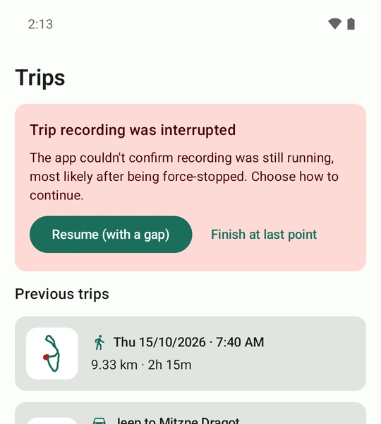
</p>

### Marking spots

While a trip records, **Mark spot** saves where you are, with no questions: a spring, a viewpoint,
a tricky passage, a place to come back to. The app confirms with *Spot 3 marked*, and spots are
numbered per trip.

<p align="center">
  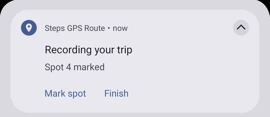
  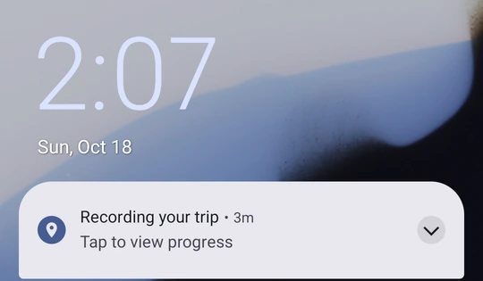
</p>

- **In the app:** the **Mark spot** button on the recording card.
- **From the notification:** pull down the notification shade and tap **Mark spot** under
  *Recording your trip*.
- **From the lock screen:** the same notification shows there; expand it and tap **Mark spot**.
  You don't need to unlock the phone, which helps with a phone in a mount. The notification's
  text says *Spot 3 marked* for a few seconds.

With no GPS fix yet, the app says so and saves nothing. A second tap before you've moved (a double
tap, a bump in the jeep) says the spot *is already marked here*. Names come later: tap the spot on
the trip's map.

### The trip screen

Tap a trip in **Previous trips** to open it.

- **Top bar.** The walk or car icon, the trip's name (or its date, if it has no name), then
  **Share**, **Edit** (pencil) and **Delete** (trash).
- **The map.** An outdoor map (see *Reading the map* below). Drag, pinch to zoom and twist to
  rotate. The button with four arrows shows the whole route again. The green dot is the start and
  the red dot the finish.
- **Colors.** The route is colored by speed, from red (slow) through yellow to green (fast). The
  small legend under the scale bar gives this trip's own km/h at each end, so a walk and a jeep
  drive both use the full range. A gray dashed stretch has no recorded points (the GPS lost its
  fix, or the trip was resumed after an interruption).
- **The panel.** The bar at the bottom shows the distance and duration. Tap it or drag it up for
  **Trip details**: the distance and duration, when the trip started and ended, the **moving
  time** (without stops), **climb / descent**, **top speed**, and an **elevation** chart with the
  highest and lowest point. Tap its top, drag it down or press Back to close it.
- **Spots.** Tap a numbered marker to see the spot's name, when it was marked and its height
  above sea level, with **Rename** and **Delete**.
- **Edit trip.** Give the trip a name (up to 60 characters) and set it to **Walk** or **Drive**.
  The app's own guess, from the trip's speed, is tagged *Suggested*. Stats counts walks and
  drives separately.
- **Delete.** The trash icon deletes the trip, its route and its spots, after you confirm. With
  *Keep deleted trips in Stats* on, its date, time and distance still count in Stats.

Heights above sea level need Android 14 or newer; older phones show the climb, the descent and the
chart's shape only.

### The map

Open the **Map** tab at the bottom. It works whether or not a trip is recording.

- **Where you are.** A blue dot, with a circle for how sure the phone is of it, a soft blue cone
  for the way the phone points (its compass) and, while you move, a small arrow for your
  direction of travel. The map follows you as you go; drag, pinch or rotate it and it stops
  following, and the round **My location** button (crosshairs) follows you again. While the map
  follows you, the screen stays on; it turns off as usual once you move the map away or leave it.
- **Map turns with me.** The navigation arrow button, above **My location**, turns the map with
  the phone, so what's in front of you is up. Above 15 km/h (driving, cycling) it turns with your
  GPS direction of travel instead, which a phone in a car holder gets right and its compass often
  doesn't; below 10 km/h it's the compass again. The arrow is filled while the map turns; tap it
  to go back to north up. Twisting the map by hand is off meanwhile. On a phone without a
  compass, the map turns only while you move.
- **The trip you're recording,** if one is: its route so far in orange, its start (green) and the
  spots you marked, growing as you go. The button with four arrows shows the whole route and
  where you are.
- **Location permission.** The first time, the map asks for location (approximate is enough here;
  the circle is just bigger). If location is off, it says so, with **Turn on location**. Until the
  first fix comes in, it says *Finding your location...*; an old fix shows as a gray dot.
- **Without internet** the map shows the areas you looked at before, from the map cache, and plain
  ground elsewhere, with your dot, the trip's route and its spots still on it. It fills in by
  itself once you're back online. If the map can't load at all, you get a plain background and
  **Retry map**.
- **Offline map of Israel.** Download it once (**Settings → Offline maps**) and the map works with
  no internet anywhere in Israel, on the Map tab and on a trip's screen. It also shows more than the
  online map: jeep tracks, paths, minor roads (such as Road 171) and wadis from far out, marked
  trails in their trail-mark colors (red, blue, green, black, and the Israel National Trail in
  orange) and contour lines (every 50 m, then every 10 m closer in, with heights). Outside its area
  the app uses the online map as before. With no offline map, a phone in Israel gets a one-time
  offer of it above the map.

The map uses your location only while the Map tab is on screen, with the app in front: switching
to another tab or app stops it at once. Nothing it shows is saved. The trip itself keeps recording
as always, whether the map is open or not. Coming back to the tab, the map is where you left it.
The compass also runs only while the tab is on screen; it needs no permission.

### Reading the map

Both maps use the app's own outdoor map, made for hikes and 4x4 drives in the desert:

- **Unpaved roads and tracks:** brown dashes (solid brown for a paved track). Jeep tracks show
  from about the 1 km scale; below that the map data leaves most of them out.
- **Hiking paths:** red dashes. Footways and sidewalks in towns are paler and thinner.
- **Wadis and seasonal streams:** blue dashes, with their names when zoomed in. A light blue patch
  on a track is a **ford**.
- **Peaks:** a brown triangle with the name and height in meters. Cliffs are a dark line.
- **Ground:** sand and dunes yellow, bare rock gray, woods and fields green. Nature reserves and
  national parks have a green edge, military areas and firing zones a faint red one.
- **Hill shading:** soft shadows show the shape of the land: ridges, valleys and crater walls.
- **Roads** are white with a gray edge, and labels are in the app's language where the map has
  them (Hebrew in Hebrew, English in English), else in the local language.

The map stays light in dark mode: it reads better outdoors, and the route's colors are made for
it. The app's own buttons and panels still follow dark mode.

### Following a route from a GPX file

1. **Get the file in.** Open a `.gpx` file with the app (**Open with → Steps GPS Route** from your
   Files app, an email or a drive), share it to the app (from a messaging app: **Share → Steps GPS
   Route**), or tap the **Routes** button on the Map tab (the top one, a winding line) and then
   **Import GPX file**. The Map tab opens with the whole route on the map.
2. **On the map** the route is a magenta band, with its start (a white dot with a magenta ring), its
   end (a magenta dot) and its waypoints as small pins with their names; tap a pin for its note and
   how far it is. A marked trail under the band still shows its color.
3. **Follow it** with the blue dot, the compass and *Map turns with me*, as usual. A strip under the
   map says, for the closest route on the map: *3.2 km done · 9.2 km to the end* while you're on it,
   *180 m off the route · ...* when you're off it, or *Start is 4.1 km away* from further off. A file
   with several tracks (one per day, say) counts along the track you're on.
4. **The Routes list** shows every imported route with its distance, climb and size. The box shows
   or hides it; tapping it shows the whole route; **⋮** has *Zoom to route*, *Rename* and *Delete*.

Imported routes stay on the phone and aren't trips: they don't show in Trips or count in Stats. The
strip works only while the Map tab is open; there are no off-route alerts. Tracks, routes and
waypoints are read; KML/KMZ files can't be imported yet.

### Sharing or saving a GPX file

1. On the trip's screen, tap **Share** (the icon at the top).
2. Android's share sheet opens. Its first entry is the app's own **Save file**: pick a folder
   (Downloads, a cloud drive...) and save. Or pick any app that accepts files, such as a messaging
   or email app, or a drive.

The file is called `steps-gps-route-trip-<date>.gpx`. It's a standard GPX 1.1 file: the route as a
track (each point with its time and height), the trip's name, and each spot as a waypoint with its
name, time and height. Open it in any app that imports GPX, such as Organic Maps or OsmAnd, usually
through the app's import option or by opening the file from your Files app.

### Settings

Tap the gear icon at the top of any tab; the back arrow, or Back, returns to that tab.

<p align="center">
  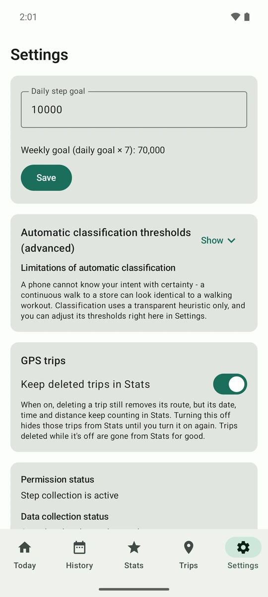
  
</p>

- **Daily step goal:** type a number and tap **Save**. The weekly goal is 7 times it.
- **Automatic classification thresholds (advanced):** tap **Show** to change the limits that
  decide what counts as a workout; **Reset to defaults** undoes it.
- **Keep deleted trips in Stats:** off by default. When on, a deleted trip's date, time, distance
  and type keep counting in Stats.
- **Offline maps:** **Download** the Israel map (about 151 MB). The download runs in Android's
  download manager, with a notification, and carries on if you leave the app; it shows its progress
  here, with **Cancel**. **Download over Wi-Fi only** is on by default. Once it's on the phone:
  **Delete**, and **Update** when a newer map is out (the app checks only when you open Settings).
- **Permission status** and **Data collection status** tell you whether step reading works.
  Without the permission, **Open Health Connect** opens Health Connect, where you allow **Steps**
  under *App permissions → Steps GPS Route*.
- **Privacy policy:** the app's full privacy policy (in English), the same screen Health Connect's
  privacy-policy link opens. It's built into the app, so it works offline; a link at the top opens
  the latest version online.

### Tips for hikes and 4x4 drives

- **Stop Android from closing the app.** Battery savers can stop a long recording. In Android's
  settings, open *Apps → Steps GPS Route → Battery* and choose **Unrestricted**. On Samsung phones,
  also make sure the app isn't in *Sleeping apps* or *Deep sleeping apps* (*Settings → Battery →
  Background usage limits*). Don't force-stop the app while recording.
- **Keep location on**, and check the card says *GPS: Good* before you start moving. Deep wadis,
  canyons and dense trees weaken the signal.
- **No mobile data needed for recording.** GPS works offline. Only the map itself needs internet:
  offline, the maps show the areas you looked at before (from the map cache) and plain ground
  elsewhere, with your dot and route still on them.
- **Compass.** If the cone points the wrong way, move the phone in a figure 8 a few times to
  calibrate it, away from the car and other metal. A magnet in a phone case or holder throws it
  off.
- **In a vehicle,** put the phone in a mount where it sees the sky (a windshield mount works
  well), keep it charging on long drives, and keep it out of direct sun on the dashboard. Mark
  spots from the lock screen without unlocking.
- **On long hikes,** carry a power bank: recording keeps the GPS on, which uses battery, more so in
  cold weather or with a weak signal.
- **After the trip,** check whether it's a Walk or a Drive and give it a name, so Stats and the
  GPX file make sense later.

### Troubleshooting

| Problem | What to do |
|---|---|
| Steps stay at 0, or *Waiting for first step data* | If the banner asks for permission, allow **Steps** (see *First launch* above). Otherwise Health Connect has no steps: see *If steps stay at 0* above. |
| *Step tracking is not available on this device* | The phone runs Android 13 or older, or has no Health Connect step counting. Trips still work. |
| Health Connect no longer asks for permission | After two "Don't allow" answers it stops asking. Once a request comes back without permission, the banner shows **Open Health Connect** instead (if it still says *Grant permission*, tap that once). Tap it, go to *App permissions → Steps GPS Route*, switch on **Steps**, and press Back. |
| *Open Health Connect* opens the app's Android settings | The phone's Health Connect couldn't be opened directly. Tap *Permissions → Health, fitness and wellness* (the name varies by phone) and switch on **Steps**. |
| *The newest step data is too old* | No new steps came in for 2 days. Check the Health Connect permission and the app that writes your steps. |
| A trip says *interrupted* | Android stopped the app. Resume or finish it, and set the app's battery use to **Unrestricted**. |
| *Precise location required* | You chose approximate location. Tap **Open app settings** and turn on *Use precise location*. |
| No recording notification | Notifications are off for the app. Recording still works; turn them on in the app's settings to get *Mark spot* on the lock screen. |
| The notification isn't on the lock screen | Allow notifications on the lock screen in Android's settings (lock screen or notification settings). |
| *GPS: Searching* while you stand still | Normal: no new points are kept while you don't move. It goes back to *Good* when you walk on. |
| The map is blank or plain | No internet. Areas you looked at before still show; elsewhere the ground is plain, with your dot and route on it. It fills in once you're back online. If it says *Retry map*, tap that. |
| The cone or the turning map points the wrong way | Calibrate the compass: move the phone in a figure 8, away from cars and metal. Above 15 km/h, *map turns with me* uses the GPS direction of travel instead. |
| No blue dot on the map | Tap **Allow** above the map, or **Turn on location**. If it says *Finding your location...*, step outside or wait a little. |
| No heights, climb or chart | The phone didn't report heights for most of the trip. |

## How it works

The full details are in [docs/how-it-works.md](docs/how-it-works.md): which GPS points are kept,
how a route is cleaned up, speed colors, moving time and top speed, heights, spots, the map, the
offline map packs and the compass. In short:

- **Steps** come from Health Connect, which the phone (or your watch's app) keeps filling. The app
  copies them in only while it's open, reaching back up to 30 days, and never writes anything
  back. It never runs in the background.
- **Workout or incidental.** A walk of at least 10 minutes and 600 steps, at 60 steps a minute or
  more, is a *workout*; everything else is *incidental*. The limits can be changed in Settings.
- **Trips** ask for a GPS point every 10 seconds while a trip you started records. Inaccurate
  points, drift while you stand still and jumps the phone's own speed can't explain are skipped.
- **One route everywhere.** The map, the distance, the speed colors and the GPX file all use the
  same cleaned, smoothed route, so they always agree. The stored points never change.
- **Walk or drive** is suggested from the route's speed (a drive when at least a tenth of it is
  faster than 15 km/h); your choice in *Edit trip* wins.
- **Heights** are smoothed before climb and descent are counted, and shown above sea level on
  Android 14 and newer.
- **Steps and trips are separate.** Recording a trip doesn't change your step counts, and deleting
  a trip never removes steps. Step code never uses location, and trip code never reads steps.

## Permissions

| Permission | Used for | When it's asked |
|---|---|---|
| Health Connect: *Read steps* | Your step counts | When you tap *Grant permission* on *Today*. If you said no, *Open Health Connect* opens Health Connect, where you can allow it under *App permissions*. |
| Precise location | Recording a trip's route | When you tap *Start trip* or *Resume*, after the app's own explanation |
| Notifications | The notification shown while a trip records | Together with location, on Android 13 and later. Recording still works if you say no. |
| Foreground service (location) | Recording with the screen off | Granted automatically |
| Location (approximate is enough) | Your blue dot on the **Map** tab | When you tap *Allow* above the map. Already granted if you've recorded a trip. |
| Internet | Loading the map (OpenFreeMap) and its hill shading (Mapterhorn) on a trip's screen and the **Map** tab; downloading an offline map you ask for (GitHub) | Granted automatically |

The app never asks for background location. It uses location only while a trip is recording or
the **Map** tab is open. The compass needs no permission, and neither does importing a GPX file:
the app reads only the file you open, share or pick.

## Privacy and data

The full privacy policy is at <https://elibukin.github.io/steps/privacy-policy.html>, and in the
app under **Settings → Privacy policy**. In short:

- Steps, trips and settings are stored only on the phone. Android's cloud backup is turned off for
  this app.
- The app sends nothing to the developer or anyone else. Its only internet traffic is loading the
  map from OpenFreeMap, and its hill shading from Mapterhorn, while a trip's screen or the **Map**
  tab is open. Those requests don't include your GPS points, but like any map they show
  OpenFreeMap and Mapterhorn which area you're looking at (on the Map tab, usually the area around
  you), and your IP address. Mapterhorn keeps request logs, with IP addresses, for up to 30 days.
- An offline map downloads only when you tap **Download** or **Update**, from GitHub, which sees
  your IP address like any download; the app checks GitHub for a newer map only when you open
  Settings. Inside a downloaded map's area, the map makes no internet requests at all.
- The compass reads the phone's sensors only while the Map tab is open, and nothing it reads is
  stored or sent.
- Locations come from Google Play services' location service on the phone, which may also use
  Wi-Fi and mobile networks, depending on the phone's location settings.
- A GPX file leaves the app only when you save or share it yourself.
- A GPX file you import is read on the phone, with no internet; its route is kept only on the
  phone until you delete it. The file itself isn't kept.
- Step data is never written back to Health Connect.

## Map data and licenses

The map's (i) button lists these credits too.

- **Map data** © [OpenStreetMap](https://www.openstreetmap.org/copyright) contributors, under the
  Open Database License.
- **Vector tiles** in the [OpenMapTiles](https://openmaptiles.org) schema (© OpenMapTiles), served
  free by [OpenFreeMap](https://openfreemap.org), which also serves the map's fonts and icons.
- **Hill shading** © [Mapterhorn](https://mapterhorn.com/attribution), built from open elevation
  data; that page lists each source, such as Copernicus GLO-30 worldwide and a 10 m model of Israel.
- **The outdoor style** is the app's own, written for it. A few of its rules, such as the road
  number signs, follow OpenMapTiles' [OSM Bright](https://github.com/openmaptiles/osm-bright-gl-style)
  style (© MapTiler.com & OpenMapTiles contributors, © Mapbox; code BSD 3-Clause, design CC BY 4.0).
- **MapLibre Native** and **maplibre-compose** draw the map (BSD 2-Clause and BSD 3-Clause).
- **Offline maps** are built from the same sources: OpenStreetMap data (© OpenStreetMap
  contributors; the packs are published under the Open Database License, and
  `scripts/offline-maps/` is how they're made), OpenMapTiles' schema (© OpenMapTiles, CC BY 4.0),
  Natural Earth (public domain) at low zoom, and Mapterhorn's terrain (© Mapterhorn; in Israel
  from Copernicus GLO-30, © DLR e.V. 2010-2014 and © Airbus Defence and Space GmbH 2014-2018
  provided under COPERNICUS by the European Union and ESA, and ASTER GDEM, courtesy of METI and
  NASA). Planetiler, GDAL and tippecanoe build them; none of them ships in the app.
- **Fonts and icons for offline maps** ship in the app: Noto Sans (© The Noto Project Authors,
  SIL Open Font License 1.1, text in `app/src/main/assets/map/glyphs/OFL.txt`) and OpenFreeMap's
  map icons (MIT; the POI icons are Maki, CC0).

## Known limitations

- **Driving needs the phone's speed.** Above about 22 km/h, points are kept only while the phone
  reports its speed. GPS points normally include it; if the phone stops reporting it, points are
  skipped until you slow down, and the route shows a straight jump.
- **GPS jumps are harder to catch while driving.** The faster the phone says you're going, the
  bigger the gap between two points the app allows, and the out-and-back cleanup above is for
  walking only (at driving speed a hairpin bend has the same shape). While driving, a stray point
  a few hundred meters to the side of the road can stay in the route.
- **"Searching" while standing still.** The GPS status can show *Searching* after 30 seconds
  without moving, because no new points are kept then.
- **Heights are only as good as GPS.** Even after smoothing, the climb and descent are estimates,
  good to about 10-20%, and the highest and lowest point are often 5-10 m off. A slow drift of the
  GPS height over minutes looks just like a gentle hill, so a flat walk can still show some climb,
  and hills smaller than about 10-15 m are missed. Telling the two apart would need a barometer,
  which the app doesn't use.
- **Steps update only while the app is open.** The phone keeps counting, but if you don't open
  the app for more than 30 days, the steps from before that are never copied in.
- **Android 14+ only for steps.** Older phones get no step counting.
- **Workout vs. incidental is a guess.** A long, brisk walk to the shop counts as a workout.
- **A trip stops if Android closes the app.** It stays *interrupted* until you resume it.
- **Spots on the map only.** Spots show on the online map, not on the offline outline, and
  TalkBack can't reach a single spot on the map: the map's description only says how many there
  are. Their heights show only on Android 14 and newer.
- **A permission answer can be lost.** If the screen rotates while a permission dialog is open,
  tap *Start trip* again.
- **The map's detail.** Online, zoomed out past about the 1 km scale, the map data leaves out most
  tracks and paths, and there are no contour lines or marked-trail colors; the offline map of
  Israel has them. There are no 4x4 grades either way.
- **Offline maps: Israel only, for now.** Where two marked trails share a path, only one color
  shows. Crossing the edge of the offline map's area (or zooming out past about zoom 7) switches
  between it and the online map, which redraws the map once. An update downloads the whole map
  again.
- **Imported routes.** *Open with* offers the app for a `.gpx` file only when the phone knows it's
  GPX or its address ends in `.gpx`; from the Files app's Downloads list or a messaging app's
  *Open*, use *Share* or *Import GPX file* instead. Following a route works only with the Map tab
  open: no off-route alerts, no turn-by-turn, no height chart for the route. KML/KMZ isn't read.
- **The compass is only as good as the phone's.** Near a car, metal or a magnet it can be off by
  tens of degrees until it's calibrated.

## For developers

> The project and its Kotlin package are still called **StepSplit** (`com.example.stepsplit`).
> The app's ID on phones and Google Play is `bukin.stepsgpsroute` (`bukin.stepsgpsroute.debug` for
> debug builds).

### Project structure

A single `app` module in Kotlin and Jetpack Compose. Dependencies are wired by hand in
`di/AppContainer.kt` (no DI framework). Data flows from Room and DataStore through repositories into
ViewModels (`StateFlow`), and from there to the Compose screens.

```
app/src/main/java/com/example/stepsplit/
  ui/               Compose screens (today, history, stats, trips, map, settings), navigation, theme
  di/               AppContainer and ViewModelFactory
  domain/           Pure Kotlin, no Android: walk classification, aggregation, time,
                    lifetime stats, and the trip route logic (point acceptance, cleanup, smoothing,
                    speed colors, walk/drive, moving time and top speed, elevation, which GPS
                    point a marked spot uses), and imported routes (simplifying, measuring,
                    following)
  data/
    stepsource/     Health Connect step source (+ a fake for tests and debug data)
    repository/     StepRepository: imports, stores and classifies steps
    trip/           TripRepository, GPS location client, recording coordinator, spot marker,
                    sea-level heights
    route/          Imported GPX routes: the GPX parser, ImportedRouteRepository, reading a file
                    the owner opened or shared
    local/          Room database, entities and DAOs
    settings/       DataStore settings (goal, thresholds, last sync, keep deleted trips)
    mappack/        Offline map packs: the server's list (maps.json), the files on the phone,
                    downloads through Android's download manager
  trip/service/     The trip recording foreground service and its command handling
  sync/             Cancels a background job left by older app versions (nothing is scheduled)
  debug/            Debug-only sample data and device diagnostics
scripts/offline-maps/  Builds the offline map packs and maps.json (see its README)
```

The privacy policy's source is `docs/privacy-policy.html`. It's published on GitHub Pages from the
`gh-pages` branch as `privacy-policy.html`, next to the app's web page, whose source is
`docs/site/` (see [docs/RELEASING.md](docs/RELEASING.md#publishing-the-web-page-and-the-privacy-policy)).
Each build also copies the policy into the
app's assets (`CopyPrivacyPolicyTask` in `app/build.gradle.kts`), where the Health Connect
rationale screen, `ui/PermissionsRationaleActivity.kt`, shows it in a WebView with network loads
blocked. Health Connect requires that screen to show the same policy as the Play listing, so
publish the policy whenever a release ships a changed copy. The page must stay self-contained (no
scripts, images, stylesheets or fonts from elsewhere); a unit test checks this. A draft of the
Google Play store listing is in `docs/store-listing.md`, and the README's screenshots are in
`docs/screenshots/`. The details of how the app works are in `docs/how-it-works.md`.

### Build, install, test

You need **JDK 21** (the unit tests need it; building alone works with JDK 17) and the Android SDK
with platform 36.

```bash
./gradlew assembleDebug        # APK: app/build/outputs/apk/debug/app-debug.apk
./gradlew installDebug         # installs on every connected device and emulator
./gradlew testDebugUnitTest    # unit tests (JVM + Robolectric)
./gradlew lintDebug
```

- **Tests.** About 810 unit tests. Business logic is pure Kotlin; Room and the screens' ViewModels
  run under Robolectric. There are no instrumented (on-device) tests.
- **Step separation.** `ArchitectureInvariantsTest` scans the code to make sure step and trip code
  don't import each other, and `StepGpsSeparationTest` runs both features together.
- **Real phone.** Step counting needs a real phone with Health Connect step counting. Most
  emulator images report step tracking as unavailable, because their SDK extension level is
  below 20. To see the step screens on an emulator anyway (for screenshots, say), run
  `adb root` and `adb shell setprop build.version.extensions.u 20` before starting the app, and
  grant the permission with `adb shell pm grant bukin.stepsgpsroute.debug
  android.permission.health.READ_STEPS`. Health Connect has no steps there, so the steps have to
  be put into the app's database.
- **Emulator.** Trips can be tested on an emulator by feeding it positions with
  `adb emu geo fix <longitude> <latitude>`, about one per second.
- **Map renderer.** The trip map uses MapLibre's OpenGL ES build (`android-sdk-opengl`) instead of
  the Vulkan one maplibre-compose brings, so Google Play doesn't hide the app from phones without
  Vulkan. Keep `maplibreAndroid` in `gradle/libs.versions.toml` at the version maplibre-compose
  asks for. On an emulator started with `-gpu swiftshader_indirect`, the map then misses its
  labels, spot numbers and gap lines, a known emulator bug
  ([maplibre-native#3648](https://github.com/maplibre/maplibre-native/issues/3648)); start it with
  `-gpu swangle` instead.
- **Debug tools.** Debug builds (`bukin.stepsgpsroute.debug`) add a *Debug tools* section in
  Settings:
  - *Generate sample data*: a week of fake steps, stored under a separate source so they never
    count toward lifetime stats;
  - a step source check;
  - device diagnostics.

  None of this exists in release builds.

### Releasing

Google Play releases are built, checked and signed with `scripts/release.sh`, from one commit in
an isolated checkout, into a read-only, git-ignored `dist/` folder. The upload key stays outside
the repository, and `jarsigner` asks for its password. See [docs/RELEASING.md](docs/RELEASING.md)
for the upload key, version codes and the release steps:

```bash
scripts/release.sh build main                      # gates + checks -> dist/<release>/
scripts/release.sh sign dist/<release> <keystore> upload
scripts/release.sh test-apk dist/<release>         # debug-key copy of the release APK for testing
```

Debug builds installed before the ID change (`com.example.stepsplit.debug`) are a separate app;
docs/RELEASING.md also explains how to move their data.

### Database

- **Version.** Room schema version **11**. The 10→11 migration added three empty tables for routes
  imported from GPX files (`imported_routes`, `imported_route_points`, `imported_route_waypoints`);
  points and waypoints are deleted with their route. The 9→10 migration added the empty
  `trip_spots` table for marked spots, which are deleted with their trip. The 8→9 migration added trip names and
  types: existing trips get no name and keep the suggested type, and deleted trips kept in Stats
  from before then get their type from their average speed (10 km/h or more is a drive; their
  route is gone). Each version's schema is exported to `app/schemas/` and
  committed. Migrations never delete steps or change step counts; the 5→6 migration did drop the
  old manual-relabelling table (`session_overrides`).
- **Migration tests.** Each step from 1→11 has a test in `StepSplitDatabaseMigrationTest`. It
  builds the old schema from its exported JSON, migrates, and lets Room validate the result.
- **Unused leftovers.** Some tables and columns from removed features are kept but unused:
  `manual_walks`, `activity_intervals`, `motion_evidence`, `temporal_continuity_state`,
  `step_counter_samples`, and the validation columns in `step_buckets`. Dropping them would need
  its own migration.
- **Step source id.** Steps from Health Connect are stored under the source id
  `local_recording_api`, the old source's id, so earlier history stayed in place without a
  migration.
